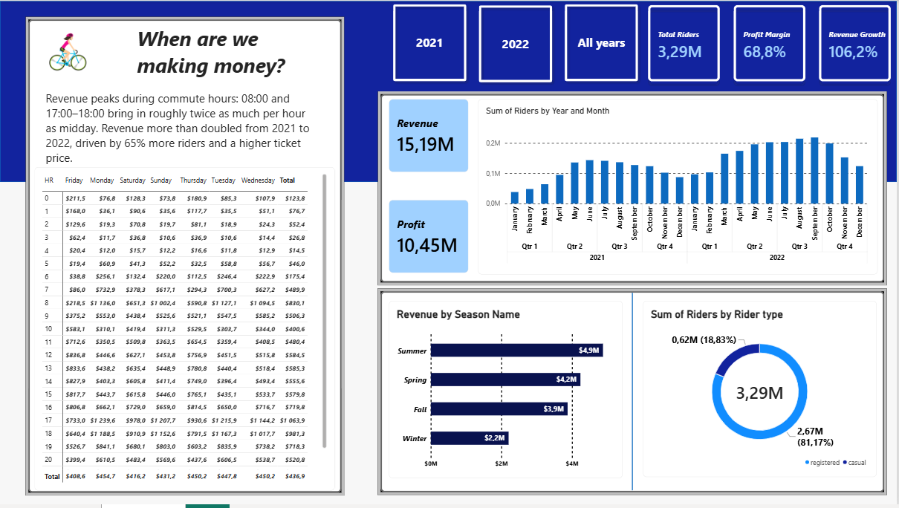

# Bicycle Rentals Dashboard: Oracle SQL and Power BI

An end-to-end analysis of 34,758 hourly bike-rental records (2021–2022). The data is stored in an Oracle database, combined and enriched with SQL (revenue, cost and profit per record), then visualised in an interactive Power BI dashboard that answers one question: **when are we making money?**



## Data

- Three tables: `customer_0`, `customer_1` (hourly rides by rider type) and `price` (ticket price and cost of goods sold per year).
- 34,758 rows in total.

## Workflow

1. **Storage:** the tables were created in an Oracle database and managed in Oracle SQL Developer.
2. **Preparation:** the text column `dteday` was converted into a proper `DATE` column (`dte`) with `ALTER TABLE` and `UPDATE ... TO_DATE(...)`.
3. **Main query:** a CTE merges `customer_0` and `customer_1` with `UNION ALL`, then a `LEFT JOIN` to `price` on year adds the ticket price and cost. Three calculated columns are created: `revenue = riders * price`, `cost = riders * cogs`, `profit = revenue - cost`.
4. **Dashboard:** the query result was loaded into Power BI and the dashboard was built on top of it.

## Dashboard

- **KPIs:** total riders 3.29M, revenue 15.19M, profit 10.45M, profit margin 68.8%, revenue growth 106.2% (2022 vs 2021)
- Average revenue by hour of day and weekday (matrix)
- Riders by year and month
- Revenue by season
- Riders by rider type (registered 81.2%, casual 18.8%)
- Year slicers (2021, 2022, all years)

## Key findings

1. **Two seasons generate most of the revenue.** Summer ($4.9M) and Spring ($4.2M) together bring $9.1M, about 60% of the total $15.19M. Summer earns 2.2 times more than winter ($2.2M). The monthly rides chart shows the same pattern: peaks in summer and early autumn (around June 2021 and September 2022), lows in winter.
2. **2022 is stronger than 2021 in every month, winter included.** Every monthly bar of 2022 is higher than the matching bar of 2021. From December 2021 (about 0.09M rides) to January 2022 (about 0.10M) rides grew instead of dropping, as a winter would suggest. So the +106.2% revenue growth does not come from one good summer; it lasted the whole year. It is driven by 65% more riders and a higher ticket price.
3. **The hour of the day matters much more than the day of the week.** Average revenue by hour ranges from $14.5 (04:00) to $1,063.9 (17:00), while the weekday totals only range from $408.6 (Friday) to $454.7 (Monday), a difference of about 11%. The three peak hours are 17:00 ($1,063.9), 18:00 ($981.3) and 08:00 ($830.1). Midday hours (12:00-15:00) average about $576, so 17:00 earns about 85% more, 18:00 about 70% more and 08:00 about 44% more. Night hours (01:00-05:00) stay below $77.
4. **The business relies mainly on registered riders.** Registered riders make up 2.67M rides (81.17%), casual riders 0.62M (18.83%). Ticket price is the same for both types in this data, so revenue follows the share of rides. The peaks at 08:00 and 17:00-18:00 fit a commuting pattern, which suggests regular daily users (a hypothesis; the dashboard does not split hours by rider type).
5. **Margin is constant by construction.** The profit margin is 68.8% ($10.45M profit on $15.19M revenue). Cost is calculated as riders times a fixed cost per ride, so margin does not change between hours or seasons, and all profit differences come from revenue (volume). With real cost data (fixed costs, bike redistribution) the margin would vary, which is a limitation of this dataset.

## Repository structure

```
bicycle-rentals-dashboard/
├── sql/
│   ├── 01_data_preparation.sql
│   ├── 02_main_query.sql
│   └── 03_findings.sql
├── images/
│   └── dashboard.png
├── dashboard.pbix
└── README.md
```

## Tools

Oracle Database, Oracle SQL Developer, SQL (CTE, UNION ALL, LEFT JOIN, calculated columns), Power BI
